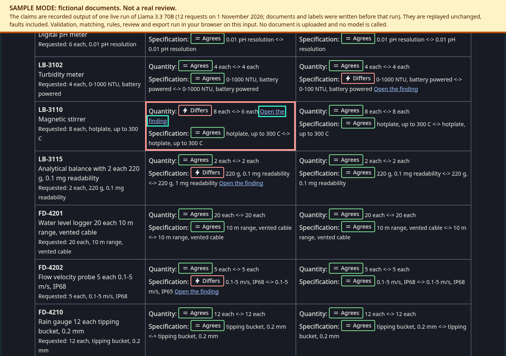
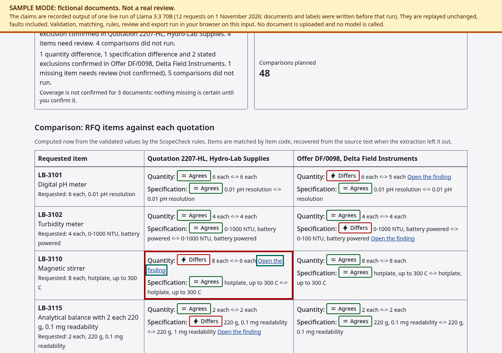
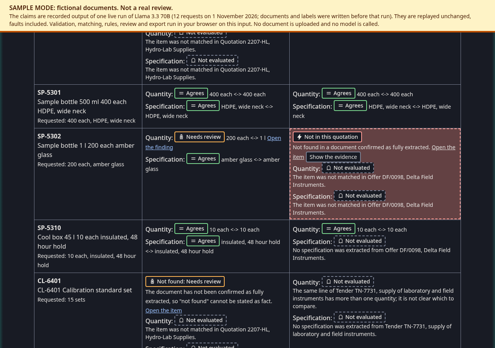
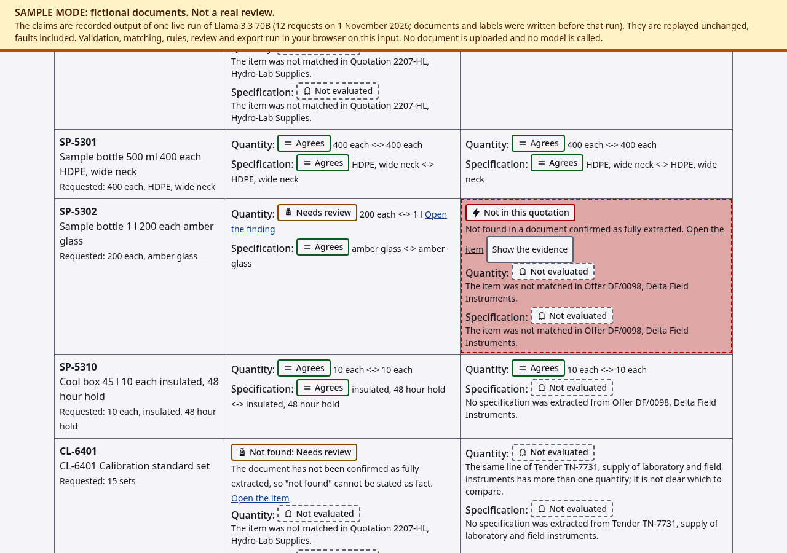
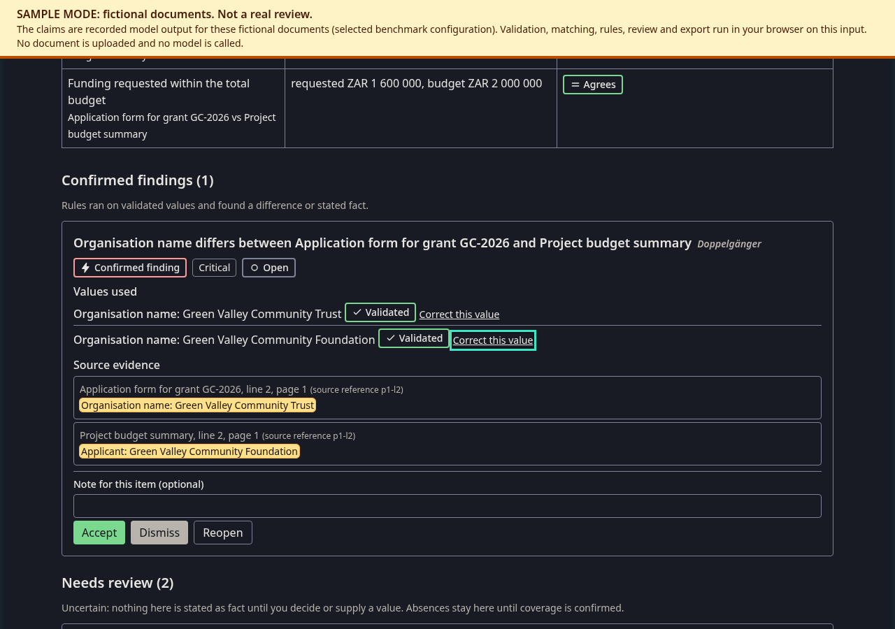
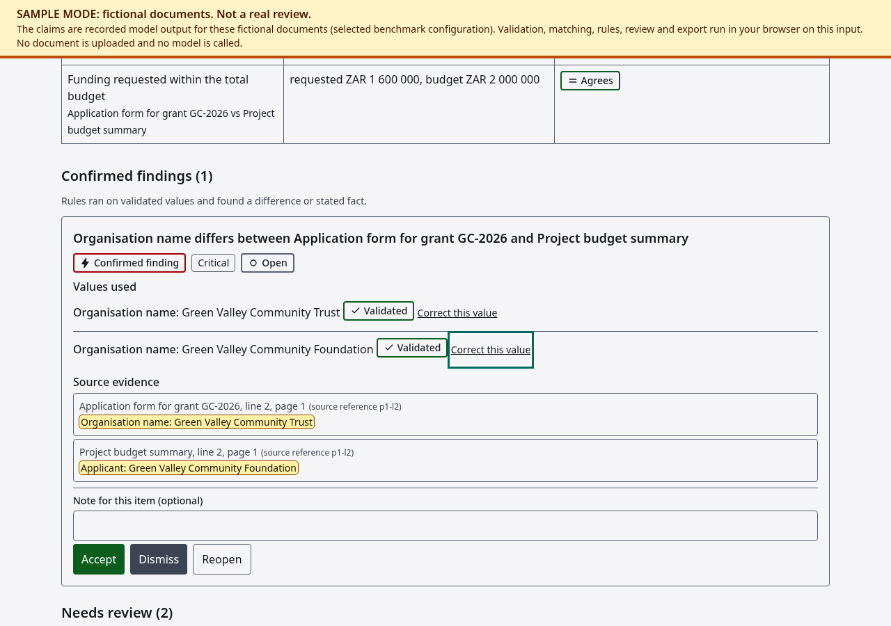

# Skeleton Key

A reusable document-checking engine powering two separate apps, built with Kiro for Kiroween 2026 (Skeleton Crew):

- **ScopeCheck** (`apps/scopecheck`): compares supplier quotations against an RFQ.
- **PackCheck** (`apps/packcheck`): checks grant-application packs for completeness and consistency.

Models extract and suggest; deterministic rules produce findings backed by validated evidence.

**Status (2026-11-03).** The haunted interface is built in both apps (see "The haunted interface" below). Earlier status, 2026-11-01: Both apps run in **sample mode** on clearly labelled fictional fixtures: validation, identity resolution, matching, rules, corrections, review decisions and export all run in the browser from fixture inputs (source text plus recorded model claims). ScopeCheck also has an **upload path** (choose an RFQ and quotation PDFs, read on your device, then an explicit Analyse step) that works against an analysis service when one is connected through `VITE_EXTRACTION_API_URL`; none is connected yet, so on this site it explains that analysis is unavailable. Real-document processing at scale is the next engineering milestone (see "Roadmap"). Production admission to the extraction Worker is closed (`DAILY_ADMISSION_CEILING = "0"`) until the limits and the deployed controls are validated.

**Privacy note (planned design):** files will be parsed in the browser, but extracted text is sent to an AI service after you start analysis. Not all processing is local.

## The haunted interface

Two modes, one product. **Lights off** is the haunted presentation (the default); **Lights on** is plain and light, and is chosen automatically when the system asks for reduced motion or more contrast. A choice made with the toggle (first control in the header) is remembered; nothing about the documents is stored.

- **Séance summary** above the ScopeCheck matrix: one sentence per quotation, with the plain counts beside it, built from the same data as the summary and the export. It never says "clean" while anything is uncertain.
- **Evidence side by side**: a difference between two documents shows both source lines with the exact cited words marked (background and outline, not colour alone).
- **Ghost rows**: a missing item stays *Needs review* until you confirm the document's coverage; then it becomes a confirmed finding and its cell turns into a ghost with a one-time flicker (none in Lights on or under reduced motion). "Show the evidence" solidifies it and jumps to the finding.
- **Theme names** are a second name next to the plain wording, in Lights off only and never in exports: ScopeCheck ghost, miscount, curse; PackCheck Lost page, Doppelgänger, Changeling, Bottomless purse.
- Checked in a real browser in both modes at 1280 px and 375 px (`npm run a11y`: axe-core, focus rings, no sideways scroll, no decoration over text, reduced motion). No sound, no third-party code, no image over 20 kB.

| Lights off | Lights on |
| --- | --- |
|  |  |
|  |  |
|  |  |

## Layout

| Path | Purpose |
| --- | --- |
| `apps/scopecheck`, `apps/packcheck` | Separate runnable apps |
| `packages/engine` | Domain-neutral engine (must not import app code) |
| `packages/ui` | Components shared by both apps |
| `services/extraction-api` | Cloudflare Worker (extraction profiles, limits, admission counter) |
| `tools/benchmark` | Live-extraction benchmark, model comparison, fixture builder |
| `samples/` | Fictional sample documents (`scopecheck*`, `packcheck*`, realistic and fresh-validation sets with pre-registered labels), `fixtures/` (app inputs), `benchmark-results/` |
| `.kiro/` | Steering and specs (requirements, design, tasks) |
| `docs/build-log.md` | Factual build record |
| `docs/model-comparison.md`, `docs/handoff-task-6.md` | Model decision; Task 6 handoff |
| `docs/reference/scopecheck-build-brief.md` | The original build brief (historical; approved amendments in `.kiro/steering/brief.md` take precedence) |
| `docs/hooks.md`, `docs/reviews/` | Hooks (configured vs actually run); source review and its resolution |
| `.kiro/specs/` | Foundation spec plus focused specs for ScopeCheck, PackCheck and the haunted interface; `README.md` there is the index with introduction dates |

## Commands (Node 20+)

```bash
npm install
npm run dev:scopecheck      # http://localhost:5173
npm run dev:packcheck       # http://localhost:5174
npm run build:scopecheck    # builds independently of PackCheck
npm run build:packcheck     # builds independently of ScopeCheck
npm run preview -w @skeleton-key/scopecheck   # serve the built app on http://localhost:4173 (PackCheck: 4174)
npm run lint && npm run typecheck && npm test && npm run build
npm run a11y                # browser checks of both apps in both modes (build first; needs Playwright's Chromium)
```

## Try the sample mode

1. `npm install`, then `npm run dev:scopecheck` (or `dev:packcheck`) and open the printed address.
2. The amber **SAMPLE MODE** banner is always visible. Nothing is uploaded and no model is called.
3. ScopeCheck: comparison table of RFQ items against each quotation (switch to the free-text sample with the selector). PackCheck: attachment checks and field checks across the pack.
4. Every item with a source shows the cited text highlighted. **Needs review** items and **Not evaluated** comparisons (which did *not* run, with the reason and the blocked input) have their own sections.
5. Try: *Correct this value* on a held value (for example the ambiguous start date in PackCheck), *Accept* or *Dismiss* a finding, *confirm coverage* of a document (an omission only becomes a confirmed finding after that), then *Download CSV / text* (all states are kept) or *Print*.
6. Keyboard: Tab through the page (skip link first), Enter or Space on buttons and links; the correction editor takes focus when it opens, and results are announced to screen readers.

Regenerate the fixtures from the samples with `npm run fixtures -w @skeleton-key/benchmark`. Screenshots: `docs/screenshots/`.

## Roadmap (what is next, in order)

1. Merge PR #4 (samples, benchmark, model decision) and PR #5 (both apps in sample mode, reviewed).
2. **Real documents, multi-chunk first:** original multi-page documents for both apps with expected outputs committed before extraction; upload, chunking, live wiring. A failed or missed chunk can never yield a confirmed absence. Specs: `scopecheck-real-documents`, `packcheck-real-documents`.
3. Production limits (task 5.5) and validation of the Workers AI binding and the deployed Durable Object, before any public access.
4. The shared haunted interface (`haunted-ui`): Lights off (haunted) and Lights on (plain), both with readable evidence, keyboard access, AA contrast and reduced motion.
5. Then 2 to 5 quotations, DOCX and supplier-specific clarification email drafts, before final regression.

Targets: ScopeCheck upload workflow deployed by **22 November**; PackCheck working upload workflow by **29 November**. If scope must shrink, both apps, evidence quality and the review states (Needs review, Not evaluated, coverage) are protected; DOCX, extra quotations, email drafts and decoration go first.

## Measured, not promised

The model (`@cf/meta/llama-3.3-70b-instruct-fp8-fast`) was chosen over `@cf/meta/llama-3.1-8b-instruct` by a pre-registered comparison on fictional documents (`docs/model-comparison.md`). The benchmark envelope is single-chunk text PDFs of up to about 400 characters; nothing beyond it is validated. The 70B model misses some extractions (for example one specification in the free-text sample), and the apps show such gaps as Not evaluated rather than hiding them.

## Licence

MIT
